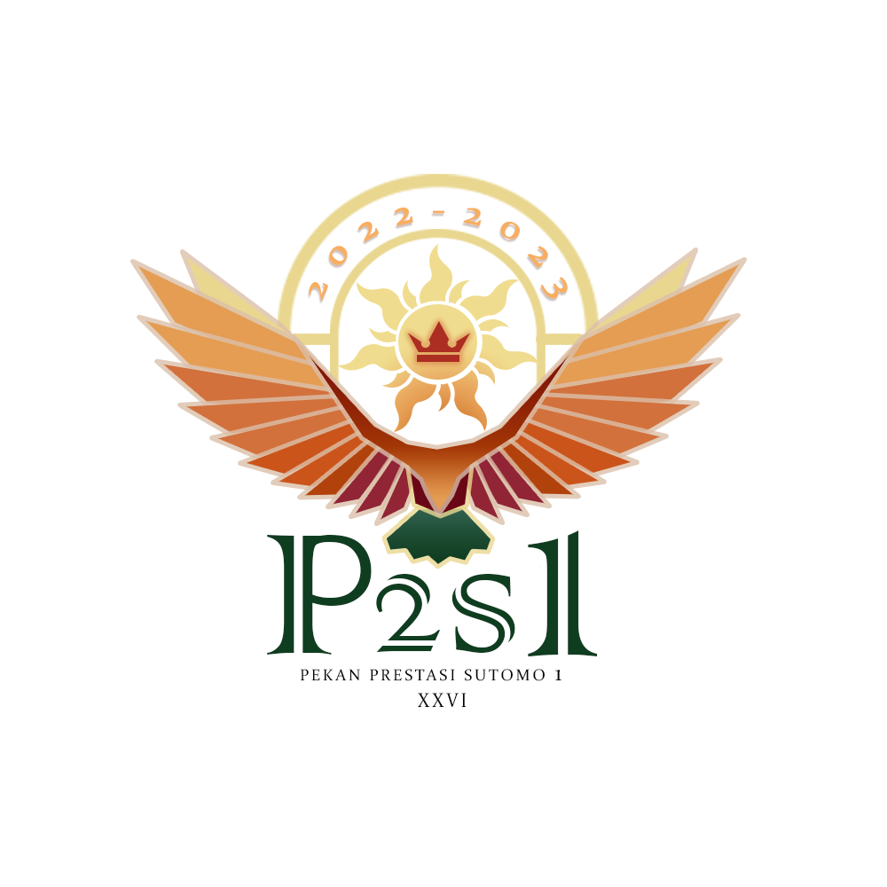
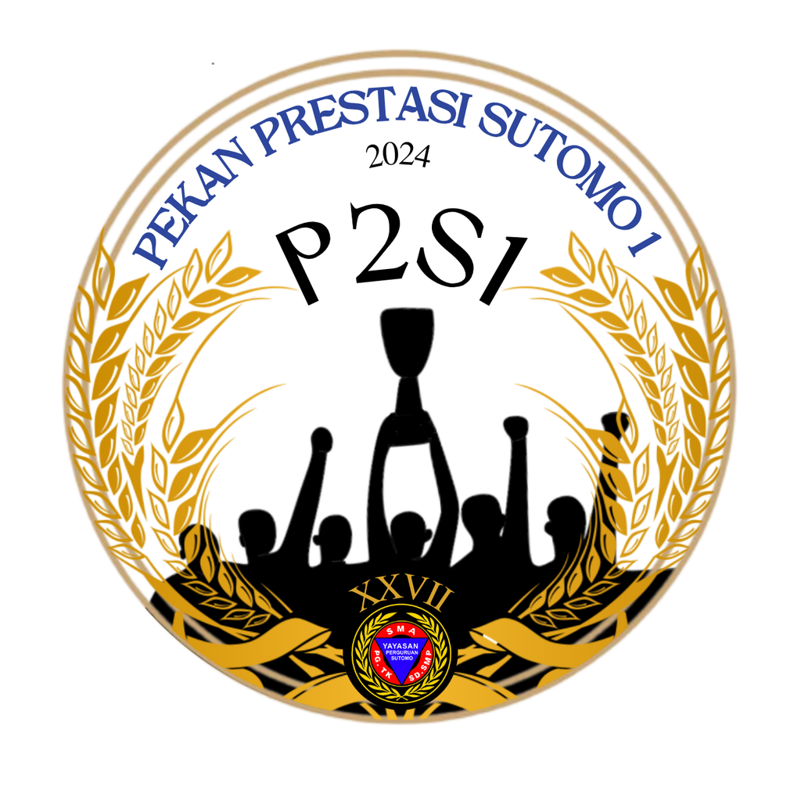
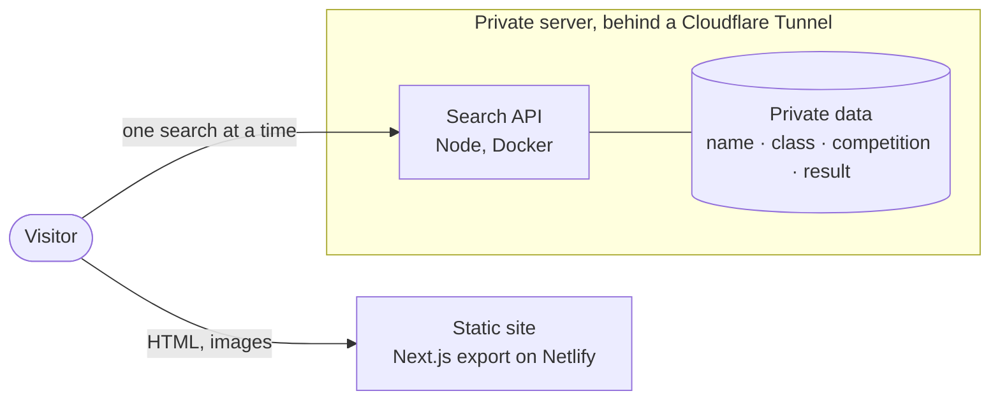

<div align="center">

&nbsp;
&nbsp;
&nbsp;


# P2S1 — Pekan Prestasi Sutomo 1

An archive of **Pekan Prestasi Sutomo 1**, the annual competition week held by OSIS at SMA Sutomo 1 Medan.<br>
Photos, stories, results and class championships from every edition, in English and Bahasa Indonesia.<br>
<sub>An unofficial archive kept by alumni who were once part of OSIS. Not an official OSIS SMA Sutomo 1 website.<br>
Requests or updates: <a href="mailto:me@stanleyowen.com">me@stanleyowen.com</a></sub>

**[p2s1.stanleyowen.com](https://p2s1.stanleyowen.com)** · [Bahasa Indonesia](https://p2s1.stanleyowen.com/id) · [p2s1.netlify.app](https://p2s1.netlify.app)

[](https://nextjs.org)
[](https://p2s1.stanleyowen.com)
[](LICENSE)

</div>

---

## Editions

| Edition | Year | Theme | Participants | Entries | Competitions | Results on the site |
|---|---|---|---:|---:|---:|---|
| [XXIX](https://p2s1.stanleyowen.com/2026) | 2026 | — | — | — | — | Winners announced by OSIS |
| [XXVIII](https://p2s1.stanleyowen.com/2025) | 2025 | *Areté* | 1,329 | 2,966 | 63 | Official podium + every registered participant |
| [XXVII](https://p2s1.stanleyowen.com/2024) | 2024 | *Amelioration* | 1,319 | 2,558 | 47 | Official recap, every participant |
| [XXVI](https://p2s1.stanleyowen.com/2023) | 2023 | — | 1,609 | 3,192 | 48 | Official recap, every participant |

Each edition page has the story of that year, a photo gallery, the competition list, a **participant search**, a
**champions board** (the top three of every competition) and the **juara umum** class standings.

## How it fits together



- **The site** (`/`) is a fully static Next.js export. Everything, including the photos, the copy and the class
  standings, is built ahead of time. No participant names are in the repository or the bundle.
- **The API** (`server/`) is a tiny zero-dependency Node server that answers searches and serves the champions
  boards. It runs in Docker on a private machine, reached only through a Cloudflare Tunnel, and is rate limited.
- **The data** lives only on that server. Student ID numbers are dropped before it gets there.

## Project layout

```
.
├── content/photos/          Source photos (≤2400px) and edition logos
├── scripts/
│   ├── build-images.mjs     AVIF + WebP at five widths, content-hashed, blur placeholders, social cards
│   ├── class-standings.mjs  Juara umum tables from the private data → src/content/standings.json
│   └── security-headers.mjs Hash-based CSP written to out/_headers after each build
├── src/
│   ├── app/                 Routes: /, /[year] (English) and /id, /id/[year] (Indonesian)
│   ├── views/               Home and edition pages, shared by both languages
│   ├── components/          Header, gallery + lightbox, participant search, champions board
│   ├── content/             Edition copy, stats, galleries and standings, in both languages
│   └── i18n/                Locale config and interface strings
├── server/                  Search API, its tests, Docker setup and data scripts (see server/README.md)
└── netlify.toml             Build settings, security headers, caching, legacy redirects
```

## Getting started

Requires **Node 22.12+**.

```bash
npm install
npm run dev        # builds the images on the first run (~3 min), then starts next dev
```

Participant search needs the API and the private data files. With those in `server/data/`:

```bash
cd server && npm run dev                                # API on http://localhost:8787
NEXT_PUBLIC_API_URL=http://localhost:8787 npm run dev   # site, from the repo root
```

| Script | What it does |
|---|---|
| `npm run build` | Images → static export in `out/` → CSP headers |
| `npm start` | Serve `out/` locally |
| `npm run lint` · `npm run typecheck` | ESLint and TypeScript checks |
| `npm run images` | Rebuild responsive images only (unchanged photos are cached) |
| `npm run standings` | Recompute the class standings from `server/data/` |
| `cd server && npm test` | API tests (synthetic data only) |

## Adding an edition

1. **Copy:** add an entry to `EDITIONS` in `src/content/editions.ts`, with the story, dates and competition list in
   English *and* Indonesian. Leave `stats` out until the figures are known, and keep `results: false` until the data
   is on the API server (`winnersOnly: true` if only the podium is public).
2. **Look:** add the logo at `content/photos/logos/<year>.png` and photos under `content/photos/<year>/`, then list them
   with captions and alt text in both languages in `src/content/photos.ts`.
3. **Data:** build `<year>.json` (`[{ name, class, competition, result }]`, no student IDs), copy it to the server,
   restart the API and run `npm run standings`.

## Privacy & security

- **No participant data in git or in the site.** Names, classes and results come from the API one search at a
  time. Searches return at most 10 rows (or one student's full list), need a word of 3+ letters, and are rate
  limited per client with a daily quota. Student ID numbers are never stored on the server.
- **Strict headers.** Hash-based Content-Security-Policy with no inline scripts, HSTS, `nosniff`,
  `frame-ancestors 'none'`, a locked-down Permissions-Policy, and COOP/CORP.
- **No third parties.** Fonts are self-hosted, images are served from the site itself, and photo metadata
  (EXIF/GPS) is stripped. The only other request is to the results API.
- **Hardened API.** The container is read-only, runs as a non-root user with no capabilities, has its data mounted
  read-only, is reachable only through the tunnel, and has no dependencies.

## Deployment

- **Site:** Netlify builds `npm run build` from `main` and publishes `out/`.
- **API:** code and data reach the server over SSH. The data never goes through git. See
  [`server/README.md`](server/README.md).

## Licence

The code is [MIT](LICENSE). The photos and logos in `content/photos/` are © OSIS SMA Sutomo 1 Medan and are **not**
covered by the MIT licence.
